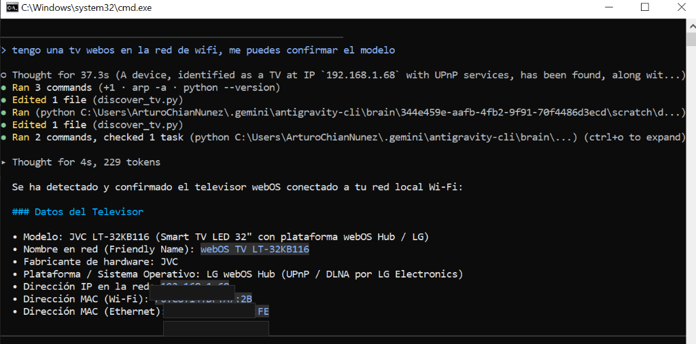

# 📺 WebOS_JVC_cleanyourtv — Suite Nativa para Windows en Smart TVs JVC (LG webOS Hub)

> **Recuperando la velocidad, simplicidad y elegancia de un Smart TV JVC con LG webOS Hub mediante una suite 100% nativa para Windows, automatización SSAP No-Root y diseño minimalista estilo Apple TV.**

[](https://microsoft.com/windows)
[](https://github.com/ArturoChianNunez/WebOS_JVC_cleanyourtv)
[](https://webostv.developer.lge.com)
[](#seguridad)
[](#licencia)

---

## 🙏 Agradecimientos y Atribución a Proyectos Predecesores (Predecessor Attribution)

Este proyecto se construye sobre la visión, arquitectura y avances de **cuatro proyectos pioneros de código abierto** que dieron vida al movimiento global **CleanYourTV / tv-vibehack** en octubre de 2026. Agradecemos profundamente a cada uno de sus autores por compartir sus conocimientos y código:

1. **[Gathin (`Gathin23/cleanyourtv`)](https://github.com/Gathin23/cleanyourtv)** *(anteriormente `tv-vibehack`)*
   - **Pionero del Movimiento y Paradigma Visual**: Diseñó el concepto estético original inspirado en Apple TV (fondo negro puro OLED/LED, dock redondeado flotante, resplandor ambiental adaptativo al color del ícono seleccionado y tipografía [Outfit](https://fonts.google.com/specimen/Outfit)). Ideó el flujo asistido por IA mediante lenguaje natural (`PROMPT.md`).
2. **[Omkar (`OmkarK97/webos-vibehack`)](https://github.com/OmkarK97/webos-vibehack)**
   - **Primer Port Puro a LG webOS (No-Root)**: Tradujo la visión de Gathin a la arquitectura webOS (`com.gathin.tvhome`) sin requerir root. Creó el cliente WebSocket SSAP (`lgtv.py`) con manifiesto sin firmar para sortear el bloqueo de certificados en firmwares modernos y desarrolló el puente de sincronización de inventario (`sync-apps.py`).
3. **[Razdva122 (`Razdva122/clean-your-tv-lg-webos`)](https://github.com/Razdva122/clean-your-tv-lg-webos)**
   - **Evolución Multiplataforma y Experiencia de Desarrollo**: Expandió el ecosistema introduciendo binarios para Windows (`cytv`), un servidor local de previsualización web en navegador (`scripts/preview.py`), traducción al español y la investigación de interceptación nativa del botón Home en webOS.
4. **[lasharor (`lasharor/cleanyourtv-WebOS`)](https://github.com/lasharor/cleanyourtv-WebOS)**
   - **Ingeniería Avanzada y Optimización de Rendimiento**: Creador de la suite para televisores LG rooteados (webosbrew), aportó optimizaciones de bajo consumo para motores Chromium de TV (animaciones aceleradas por hardware a 60 FPS restringidas a `transform` y `opacity`), integración de TV en vivo (M3U/XMLTV) y supresión de telemetría a nivel de sistema.

### Matriz de Linaje Arquitectónico

| Proyecto Predecesor | Plataforma Original | Modelo de Acceso | Contribución Clave | Rol en este Repositorio |
| :--- | :--- | :---: | :--- | :--- |
| **`Gathin23/cleanyourtv`** | Android TV / Google TV | No-Root (`adb`) | Filosofía de recuperación del TV, estética Apple TV y flujo de prompt de IA | **Inspiración estética y conceptual** |
| **`OmkarK97/webos-vibehack`** | LG webOS (OLED/LED) | No-Root (Dev Mode) | Capa SSAP WebSocket (`lgtv.py`) y sincronización de apps (`sync-apps.py`) | **Núcleo arquitectónico base** |
| **`Razdva122/clean-your-tv-lg-webos`** | LG webOS (Multiplataforma) | No-Root / Root | Herramientas `cytv`, previsualización local y localización en español | **Referencia de herramientas y UI** |
| **`lasharor/cleanyourtv-WebOS`** | LG webOS (webosbrew) | Root (SSH) | Profiling de SoC económico, animaciones 60 FPS sin tirones | **Referencia de rendimiento CSS/JS** |

---

## 🪟 Edición Especial para Windows y LG webOS Hub (JVC LT-32KB116)

Mientras que los repositorios previos dependían de scripts bash para macOS (usando comandos propietarios como `sips` para redimensionar imágenes) o requerían televisores LG OLED rooteados, **este repositorio está específicamente diseñado y optimizado para usuarios de Windows administrando televisores JVC con LG webOS Hub**.

### Hardware Probado y Validado
- **Televisor**: **JVC LT-32KB116** (Smart TV LED de 32")
- **Plataforma**: **LG webOS Hub** (licenciamiento oficial de LG para fabricantes asociados/ODM)
- **Control Remoto**: Control remoto original JVC (infrarrojo/Bluetooth sin puntero giroscópico Magic Remote)
- **Host de Control**: Windows 10 / Windows 11 (PowerShell 5.1 / PowerShell 7+)

### El Origen: Descubrimiento Autónomo en Red Local desde Windows CLI
El proyecto inició ejecutando una auditoría en lenguaje natural desde Windows (`cmd.exe` / PowerShell) para descubrir el televisor en la red Wi-Fi doméstica:



```
Modelo Detectado: JVC LT-32KB116
Nombre en Red:    webOS TV LT-32KB116
Plataforma:       LG webOS Hub (UPnP / DLNA por LG Electronics)
IP en LAN:        <TU_IP_TV> (ej. 192.168.1.100 - puerto SSAP 3001 TLS)
Modo Dev:         Puerto 9922 (SSH oficial LG Developer Mode)
```

---

<a id="seguridad"></a>
## 🛡️ Las 5 Garantías de Seguridad No-Invasivas

La integridad de tu televisor es la máxima prioridad. Este proyecto implementa **5 garantías de seguridad fundamentales**:

```
+-------------------------------------------------------------------------------+
|                       5 GARANTÍAS DE SEGURIDAD NO-INVASIVAS                   |
+-------------------------------------------------------------------------------+
|                                                                               |
|   1. 100% No-Root Sandbox                                                     |
|      Se ejecuta como app web estándar (type: "web") dentro del contenedor      |
|      oficial de LG Developer Mode. Cero acceso a particiones de sistema o ROM.|
|                                                                               |
|   2. Instantáneas SSAP Automatizadas (Snapshots)                              |
|      Antes de cualquier sincronización o despliegue, install.ps1 realiza un   |
|      respaldo completo de launch points, entradas HDMI y configuración.       |
|                                                                               |
|   3. Reversión en 1 Solo Paso (1-Step Instant Rollback)                       |
|      Un único comando (.\restore.ps1 -Latest) restaura el estado original     |
|      validando sumas de verificación criptográficas SHA-256.                  |
|                                                                               |
|   4. Cero Dependencias de macOS (Pure Windows Native)                         |
|      Elimina scripts bash y el comando 'sips' de Apple. Redimensión de        |
|      íconos 80x80 y 130x130 realizada de forma nativa en Python/Pillow.       |
|                                                                               |
|   5. 100% Reversible y Sin Riesgo para la Garantía                            |
|      No se flashean firmwares ni se alteran bootloaders. La desinstalación     |
|      de la app deja el televisor en su estado de fábrica impecable.           |
|                                                                               |
+-------------------------------------------------------------------------------+
```

---

<a id="privacidad"></a>
## 🔒 Privacidad, Seguridad y Modelo para Repositorios Públicos

Este repositorio está preparado para ser **100% público y abierto a la comunidad**, protegiendo rigurosamente la privacidad y los datos sensibles de cualquier usuario mediante directivas estrictas en `.gitignore`:

### 🛡️ Datos Protegidos y Excluidos de Git (`.gitignore`)
1. **Tokens de Emparejamiento SSAP (`.lgtv-key.json`)**:
   - Contiene la clave criptográfica privada generada durante el primer emparejamiento entre la PC y el televisor.
   - **Estado en Git**: Completamente ignorado. Cada usuario generará su propio token local al emparejar su televisor por primera vez.
2. **Instantáneas y Respaldos Locales (`backup/*`)**:
   - Los respaldos generados automáticamente por `backup.py` y `install.ps1` contienen listas de dispositivos, identificadores de red interna y metadatos específicos del hardware.
   - **Estado en Git**: La carpeta `backup/` se mantiene en el repositorio mediante `backup/.gitkeep`, pero todo el contenido generado (`backup/*`) queda excluido de Git para resguardar la privacidad de tu red doméstica.
3. **Llaves Privadas y Credenciales (`*.key`, `*.pem`, `*.id_rsa`, `*_rsa`, `.env`)**:
   - Se excluyen todas las llaves SSH de LG Developer Mode (`ares-novacom`) y variables de entorno privadas.
4. **Binarios y Archivos de Compilación (`build/`, `*.ipk`, `.agents/`, `__pycache__/`)**:
   - Evita la acumulación de artefactos de compilación temporales o logs de agentes de automatización.

### 📌 Información Técnica Pública Preservada
Para facilitar que otros usuarios con televisores similares puedan replicar este proyecto sin inconvenientes, se conservan de forma pública:
- **Marca y Modelo Probado**: JVC LT-32KB116 (Smart TV 32" LED).
- **Plataforma del Sistema**: LG webOS Hub (versión SDK 5.6.0 / SoC K6LP).
- **Mapeo de Control Remoto**: Códigos de teclado, navegación D-pad y atajos Quick Access para controles remotos estándar (sin Magic Remote).
- **Estructura de Bloatware Filtrado**: Lista de identificadores de apps promocionales e invasivas comunes en webOS Hub para facilitar su ocultación.

---

## 💻 Requisitos Previos en Windows

Antes de comenzar, asegúrate de tener instaladas las siguientes herramientas en tu PC con Windows:

1. **Python 3.9 o superior** (64-bit para Windows):
   - Descarga desde [python.org](https://www.python.org/) o vía terminal Windows:
     ```powershell
     winget install Python.Python.3.13
     ```
   - Instala las dependencias necesarias:
     ```powershell
     pip install websockets pillow
     ```
2. **Node.js 18+ LTS**:
   - Descarga desde [nodejs.org](https://nodejs.org/) o vía terminal:
     ```powershell
     winget install OpenJS.NodeJS.LTS
     ```
   - Permite ejecutar las herramientas oficiales `@webos-tools/cli` vía `npx` sin instalaciones globales conflictivas.
3. **Windows PowerShell 5.1** (incluido en Windows 10/11) o **PowerShell 7+**:
   - Para verificar tu versión: `$PSVersionTable.PSVersion`

### ⚠️ Configuración de Política de Ejecución de PowerShell (Execution Policy)

Por defecto, Windows bloquea la ejecución de scripts `.ps1`. Para habilitar la ejecución de los scripts de despliegue en tu sesión de PowerShell actual de manera segura y sin comprometer el sistema global, ejecuta:

```powershell
Set-ExecutionPolicy -Scope Process -ExecutionPolicy Bypass
```

> **Alternativa directa**: Si prefieres ejecutar sin cambiar la política de la consola, puedes invocar cualquier script directamente mediante:
> ```powershell
> powershell.exe -ExecutionPolicy Bypass -File .\install.ps1 -TvHost <IP_DE_TU_TV>
> ```

---

## 📺 Configuración Inicial en el Televisor JVC (LG webOS Hub)

1. **Conexión a la Misma Red Wi-Fi**: Conecta el televisor JVC y tu PC a la misma subred local.
2. **Habilitar LG Connect Apps**:
   - Ve a `Ajustes (Settings) -> Red (Network) -> LG Connect Apps` (o Conexión de Aplicaciones Móviles) y asegúrate de que esté en **Activado (ON)**.
3. **Instalar Developer Mode**:
   - Abre la tienda de aplicaciones (**Apps**) en tu JVC LT-32KB116.
   - Busca e instala la aplicación oficial **Developer Mode** de LG.
   - Inicia sesión con tu cuenta gratuita de desarrollador LG (regístrate gratis en [webostv.developer.lge.com](https://webostv.developer.lge.com)).
   - Enciende los interruptores:
     - **Dev Mode Status: ON**
     - **Key Server: ON**
   - Toma nota de la dirección IP que muestra la pantalla de Developer Mode y la clave de acceso temporal.

---

## 🚀 Despliegue Automatizado en Windows (`install.ps1`)

El script nativo `install.ps1` se encarga de todo el ciclo de vida de instalación y sincronización:

```powershell
# Ejecución estándar (reemplaza con la IP de tu TV JVC)
.\install.ps1 -TvHost <IP_DE_TU_TV>

# O especificando el nombre del dispositivo configurado en ares:
.\install.ps1 -TvHost <IP_DE_TU_TV> -Device jvc-tv
```

### ¿Qué hace `install.ps1` automáticamente?
1. **Verificación de Pre-Vuelo**: Comprueba dependencias (Python, Node/npx, módulos requeridos).
2. **Respaldo Automático SSAP**: Invoca `backup.py` para capturar el estado actual antes de tocar el sistema.
3. **Generación de Íconos**: Ejecuta `tools/generate_icons.py` para compilar `icon.png` (80×80) y `largeIcon.png` (130×130) usando Pillow.
4. **Sincronización de Aplicaciones**: Ejecuta `sync-apps.py` vía SSAP para descargar íconos y listar apps y entradas HDMI reales del JVC.
5. **Compilación de Paquete IPK**: Empaqueta la app web con `npx @webos-tools/cli ares-package app`.
6. **Instalación y Lanzamiento**: Instala el paquete `.ipk` en el TV con `ares-install` y lo ejecuta con `ares-launch`.

### Parámetros Disponibles en `install.ps1`:
- `-TvHost <IP>`: Dirección IP del televisor en tu red local (o variable de entorno `$env:TV_HOST`).
- `-Device <nombre>`: Nombre del dispositivo registrado en ares (por defecto: `jvc-tv`).
- `-SkipBackup`: Omite la creación de la instantánea previa.
- `-SkipIcons`: Omite la regeneración de íconos.
- `-SkipSync`: Omite la consulta SSAP de aplicaciones del TV.
- `-SkipBuild`: Omite la compilación del paquete IPK.
- `-SkipInstall`: Omite la instalación en el TV.
- `-SkipLaunch`: Omite el comando de lanzamiento final.

---

## 🔄 Sistema de Respaldo y Reversión SSAP (`backup.py` / `restore.ps1`)

Para garantizar total tranquilidad, cada modificación genera una instantánea timestamped en la carpeta `backup/<timestamp>/`:

### Contenido de una Instantánea (Snapshot):
- `snapshot.json`: Manifiesto criptográfico con metadatos y sumas de comprobación SHA-256 de cada archivo.
- `launch_points.json`: Lista completa de aplicaciones instaladas en webOS Hub vía SSAP.
- `inputs.json`: Lista de puertos HDMI y entradas externas activas.
- `system_info.json`: Información de hardware y firmware del TV.
- `apps.js`: Respaldo del inventario de aplicaciones del launcher.
- `config.js`: Respaldo de la configuración y orden de tiles del dock.
- `icons/`: Caché de íconos de las aplicaciones sincronizadas.

### Comandos de Respaldo y Restauración:

```powershell
# Crear un respaldo manual del televisor:
python backup.py --tv <IP_DE_TU_TV>

# Listar todas las instantáneas de respaldo disponibles:
.\restore.ps1 -List
# o con Python:
python restore.py --list

# Revertir al estado más reciente (1-Step Rollback):
.\restore.ps1 -Latest
# o con Python:
python restore.py --latest

# Revertir a una instantánea específica:
.\restore.ps1 -Snapshot backup/20261025_203000

# Verificar la integridad de un snapshot sin modificar archivos (Dry-Run):
.\restore.ps1 -VerifyOnly
```

---

## 🍎 Experiencia Visual Apple TV (tvOS) y Gestión de Aplicaciones

El launcher webOS (`com.gathin.tvhome`) reemplaza el pesado menú comercial de fábrica por una experiencia visual minimalista y fluida inspirada en **Apple tvOS**:

```
+-----------------------------------------------------------------------------------+
|  [ TOP SHELF ]                                                    10:30 AM        |
|                                                                                   |
|      (Ícono Grande)    MOVISTAR TV                                                |
|                        Televisión en vivo, deportes y canales nacionales          |
|                                                                                   |
|                                                                                   |
|  +-----------------------------------------------------------------------------+  |
|  | [Movistar TV]  [TV360]  [YouTube]  [Prime]  [Max]  [Paramount+] [Netflix]   |  |
|  +-----------------------------------------------------------------------------+  |
|       ^^^^ (Dock flotante de vidrio esmerilado con resplandor ambiental)          |
+-----------------------------------------------------------------------------------+
```

### Características del Diseño:
- **Top Shelf Dinámico**: La mitad superior de la pantalla muestra información destacada, logotipo y descripción de la aplicación que se encuentra enfocada actualmente.
- **Dock de Vidrio Esmerilado (Frosted Glass)**: Barra horizontal flotante inferior con fondo translúcido y desenfoque (*backdrop-filter*).
- **Resplandor Ambiental Reactivo (Ambient Glow)**: Un suave halo de luz detrás de la aplicación seleccionada que proyecta dinámicamente el color característico de la marca de streaming.
- **Íconos Reales de Alta Definición**: Se descargan directamente desde el televisor vía SSAP y se almacenan localmente en `app/icons/`.
- **Rendimiento a 60 FPS**: Animaciones estrictamente restringidas a propiedades CSS aceleradas por GPU (`transform` y `opacity`), garantizando transiciones suaves incluso en el procesador económico del televisor.

### Configuración del Dock y Supresión de Bloatware (`app/config.js`)
Puedes personalizar el orden de las aplicaciones y ocultar cualquier servicio promocional editando el archivo `app/config.js`:

```javascript
window.CONFIG = {
  // Aplicaciones fijadas en el dock principal (orden de prioridad)
  dockApps: [
    'pe.co.movistargo.itv',          // Movistar TV
    'com.viettel.media.tv360.bitel', // TV360 Bitel
    'youtube.leanback.v4',           // YouTube
    'amazon',                        // Prime Video
    'com.wbd.stream',                // Max (HBO)
    'com.pplus.webapp.prod-intl',    // Paramount+
    'netflix',                       // Netflix
    'com.disney.disneyplus-prod'     // Disney+
  ],

  // Bloatware y servicios no deseados ocultados de la vista
  hiddenApps: [
    'amazon.alexa.view',             // Amazon Alexa
    'com.joinhighbrow.highbrow',     // Highbrow
    'com.webos.app.homeconnect',     // Panel del Hogar
    'de.2kit.castbrowserlg',         // TV Cast
    'lgchannels.home'                // LG Channels
  ],

  columns: 6,
  ambientGlow: true
};
```

---

## 🎮 Mapeo del Control Remoto JVC: Atajo Quick Access (Botón 1)

A diferencia de los modelos LG OLED de gama alta que incluyen el *Magic Remote* con puntero en pantalla y rueda de scroll, el televisor **JVC LT-32KB116 incluye un control remoto infrarrojo/Bluetooth convencional con teclado numérico (0-9) y cruceta D-pad (Arriba/Abajo/Izquierda/Derecha/OK)**.

Para disfrutar de un acceso instantáneo al launcher estilo Apple TV sin necesidad de mantener una PC encendida con un script observador en red, aprovechamos la función nativa **Quick Access** de LG webOS Hub:

```
+-------------------------------------------------------+
|  GUÍA DE ASIGNACIÓN: BOTÓN 1 DE ACCESO RÁPIDO JVC     |
+-------------------------------------------------------+
|                                                       |
|  1. Abre el nuevo launcher "Home" en tu televisor     |
|     (com.gathin.tvhome) tras la instalación.          |
|                                                       |
|  2. Con el launcher visible en pantalla, toma el      |
|     control remoto de tu JVC.                         |
|                                                       |
|  3. Mantén presionado el botón numérico "1" durante   |
|     3 segundos completos.                             |
|                                                       |
|  4. Aparecerá una notificación en pantalla (toast):   |
|     "Quick Access: Asignado al número 1".             |
|                                                       |
|  5. ¡Listo! A partir de este momento, desde cualquier |
|     canal de TV, entrada HDMI (PS5, Xbox, PC) o app,  |
|     mantener presionado "1" abrirá instantáneamente   |
|     tu launcher limpio en menos de 1 segundo.         |
|                                                       |
+-------------------------------------------------------+
```

### Navegación con la Cruceta D-pad:
- **Izquierda / Derecha**: Mueve el foco horizontal entre las tarjetas de aplicaciones del dock flotante.
- **Arriba / Abajo**: Navega entre la fila de aplicaciones principales y el dock de configuración/entradas.
- **Botón OK (Enter / Tecla 13)**: Inicia la aplicación o cambia a la entrada HDMI seleccionada.
- **Botón Back / Return (Tecla 461)**: Cierra menús emergentes o regresa al dock principal.

> 📖 *Para ver la tabla completa de teclas, códigos numéricos y detalles técnicos del control JVC, consulta la [Guía Detallada de JVC y Control Remoto](docs/jvc_debloat_and_remote_guide.md).*

---

## 🧹 Guía de Desbloqueo y Menús en LG webOS Hub (JVC Debloating)

Para eliminar anuncios patrocinados, recomendaciones no deseadas y telemetría de fábrica en el firmware de tu JVC con LG webOS Hub, sigue esta navegación exacta en el menú de ajustes del TV (guía extendida disponible en [`docs/jvc_debloat_and_remote_guide.md`](docs/jvc_debloat_and_remote_guide.md)):

### 1. Desactivar Promociones y Publicidad de Inicio
- Presiona el botón de **Ajustes (Engranaje)** en el control remoto JVC.
- Navega a:
  ```
  Todos los Ajustes -> General -> Configuración de Inicio (Home Settings) -> Promoción de Inicio (Home Promotion) -> DESACTIVAR (OFF)
  ```
- **Resultado**: Elimina los banners publicitarios comerciales y trailers patrocinados del menú nativo.

### 2. Desactivar Recomendaciones de Contenido
- En el mismo submenú:
  ```
  Todos los Ajustes -> General -> Configuración de Inicio (Home Settings) -> Recomendación de Contenido (Content Recommendation) -> DESACTIVAR (OFF)
  ```
- **Resultado**: Deshabilita la fila de tendencias y sugerencias de streaming no solicitadas.

### 3. Evitar que el TV inicie en la pantalla de inicio pesada al encender
- En el mismo submenú:
  ```
  Todos los Ajustes -> General -> Configuración de Inicio (Home Settings) -> Estado al Encender (Power On Status) -> Entrada Reciente (Recent Input)
  ```
- **Resultado**: Al encender el televisor, se muestra inmediatamente la última entrada utilizada (HDMI / TV) en lugar de demorar cargando la pantalla de inicio pesada con widgets.

### 4. Desactivar Telemetría y Reconocimiento de Contenido (ACR)
- Navega a:
  ```
  Todos los Ajustes -> General -> Soporte -> Acuerdos de Usuario (User Agreements)
  ```
- Desmarca o rechaza:
  - **Información de Visualización (Viewing Information)**: Desactiva el seguimiento de hábitos de visualización (ACR).
  - **Publicidad Basada en Intereses (Personalized Advertising)**: Desactiva perfiles de anuncios dirigidos.

---

## 🧪 Suite de Verificación Offline y Dry-Run (`test_suite.py` y `test.ps1`)

Para garantizar que todo el código, configuraciones e íconos funcionen a la perfección **sin requerir una conexión activa a un televisor real**, el proyecto incluye una suite automatizada de pruebas exhaustivas:

```powershell
# Ejecutar la suite completa desde PowerShell:
.\test.ps1

# Ejecutar con salida detallada (verbose):
.\test.ps1 -VerboseOutput

# Ejecutar un nivel de pruebas específico (ejemplo: Nivel 2 de íconos):
.\test.ps1 -Tier 2

# Ejecutar directamente con Python:
python tools/test_suite.py
python tools/test_suite.py --tier 1 -v
```

### Arquitectura de los 4 Niveles de Prueba:

| Nivel | Nombre | Qué se Verifica |
| :---: | :--- | :--- |
| **Tier 1** | **Sintaxis y Esquemas Estáticos** | Valida el árbol AST de todos los scripts `.py`, sintaxis JavaScript en `app/*.js`, cumplimiento del esquema `appinfo.json` de webOS y formato de scripts `.ps1`. |
| **Tier 2** | **Generación de Íconos y Dimensiones** | Ejecuta `tools/generate_icons.py`, valida que `icon.png` sea exactamente **80×80** píxeles y `largeIcon.png` sea exactamente **130×130** píxeles, verificando firmas de cabecera PNG y canales de color. |
| **Tier 3** | **Emulación del Protocolo SSAP** | Levanta un servidor mock WebSocket que emula el apretón de manos con clave de cliente, responde a `listLaunchPoints` y `getExternalInputList`, y valida la generación de `app/apps.js`. |
| **Tier 4** | **Máquina de Estados de Respaldo y Rollback** | Genera una instantánea de prueba, valida el esquema `snapshot.json` y sus hashes SHA-256, simula corrupción de archivos y comprueba la restauración fiel byte por byte (`100% roundtrip rollback fidelity`). |

> **Garantía CI/CD**: La suite de pruebas está configurada para retornar código de salida `0` al completarse con éxito, permitiendo su integración directa en flujos de integración continua en Windows.

---

## 📁 Estructura del Proyecto

```
WebOS_JVC_cleanyourtv/
├── app/                        # Aplicación web nativa webOS (com.gathin.tvhome)
│   ├── appinfo.json            # Manifiesto oficial webOS y permisos ACG
│   ├── index.html              # Estructura del launcher Apple TV
│   ├── style.css               # Estilos optimizados a 60 FPS (transform/opacity)
│   ├── app.js                  # Navegación por control remoto y bus SSAP
│   ├── config.js               # Configuración del dock y apps fijadas
│   ├── apps.js                 # Inventario de apps sincronizadas desde la TV
│   ├── assets/                 # Imágenes y recursos base
│   │   └── icon.jpg            # Imagen fuente de alta resolución
│   ├── fonts/                  # Tipografías locales
│   │   └── outfit.ttf          # Tipografía Outfit para el launcher
│   └── icons/                  # Íconos de aplicaciones extraídos vía SSAP
├── backup/                     # Instantáneas de seguridad automáticas
│   └── latest.json             # Puntero a la instantánea más reciente
├── docs/                       # Documentación complementaria y capturas
│   └── discovery-cli.png       # Captura del descubrimiento en terminal
├── tools/                      # Herramientas de automatización y prueba
│   ├── generate_icons.py       # Redimensionador de íconos en Python (Pillow)
│   └── test_suite.py           # Suite de pruebas offline de 4 niveles
├── lgtv.py                     # Cliente WebSocket SSAP con bypass de certificados
├── sync-apps.py                # Extracción y sincronización de apps/entradas
├── home-watch.py               # Observador ligero para redirección de botón Home
├── backup.py                   # Motor de instantáneas con manifiesto SHA-256
├── restore.py                  # Motor de restauración y verificación de integridad
├── install.ps1                 # Script orquestador de despliegue para Windows
├── restore.ps1                 # Script de reversión en 1 solo paso para Windows
├── test.ps1                    # Wrapper en PowerShell para la suite de pruebas
├── README.md                   # Documentación principal del proyecto
├── PROJECT.md                  # Especificación técnica y contratos del sistema
├── TEST_INFRA.md               # Documentación de infraestructura de pruebas
└── TEST_READY.md               # Criterios de aceptación y estado de verificación
```

---

## ⚖️ Comparativa con Otros Proyectos del Ecosistema

Para contextualizar cómo encaja esta solución frente a las alternativas existentes:

| Característica | `Gathin23/cleanyourtv` | `OmkarK97/webos-vibehack` | `Razdva122/clean-your-tv` | `lasharor/cleanyourtv` | **Este Repositorio (JVC Edition)** |
| :--- | :---: | :---: | :---: | :---: | :---: |
| **Plataforma Objetivo** | Android / Google TV | LG webOS (OLED) | LG webOS (Multi) | LG webOS (Root) | **LG webOS Hub (JVC)** |
| **Sistema Operativo Host** | macOS / Linux / Win | macOS (`bash` + `sips`) | Multiplataforma (`cytv`) | Linux / macOS | **Windows Nativo (PowerShell)** |
| **Requiere Root** | No (`adb`) | No (Dev Mode) | No / Opcional | **Sí** (`webosbrew`) | **No (100% No-Root)** |
| **Respaldo SSAP Automático**| No | No | No | No | **Sí (`backup.py` + SHA-256)** |
| **Reversión en 1 Paso** | No | No | No | No | **Sí (`restore.ps1 -Latest`)** |
| **Generador de Íconos** | Manual | macOS `sips` | Python básico | Precompilado | **Python / Pillow Nativo** |
| **Atajo Control Remoto** | Botón Home Android | Observador PC | Home Helper (Magic Remote)| Daemon del sistema | **Quick Access (Botón 1 JVC)** |
| **Suite de Pruebas Offline**| No | No | No | No | **Sí (4 Tiers automatizados)** |

---

<a id="licencia"></a>
## 📄 Licencia y Descargo de Responsabilidad

- Este software se distribuye bajo la licencia **MIT**. Consulta el archivo `LICENSE` para más información.
- La tipografía **Outfit** se distribuye bajo los términos de la *SIL Open Font License (OFL)*.
- *Descargo de responsabilidad*: Este proyecto es independiente, desarrollado por la comunidad con fines educativos y de optimización personal. No está afiliado, respaldado ni asociado con JVC, JVCKENWOOD Corporation, ni LG Electronics Inc. LG webOS y webOS Hub son marcas registradas de LG Electronics.
